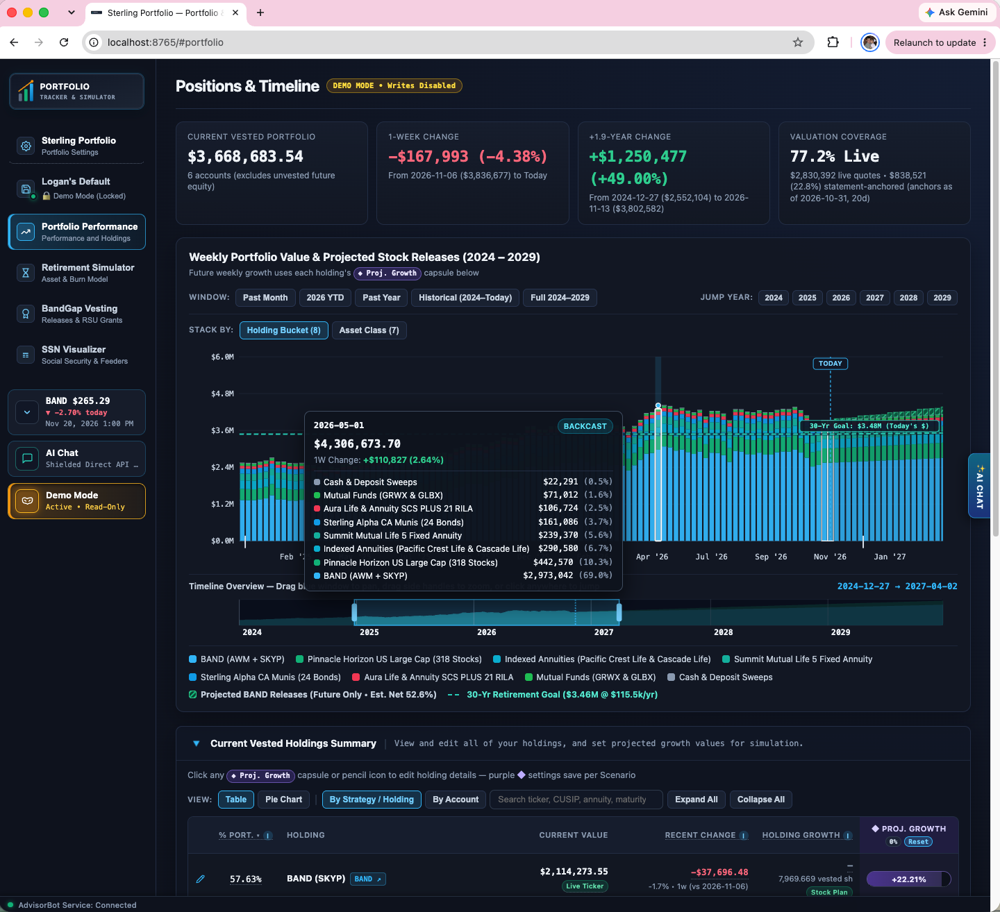
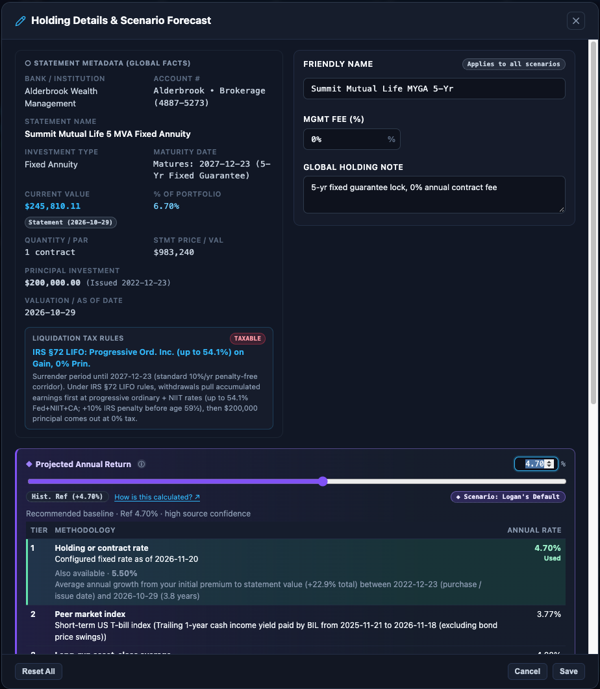
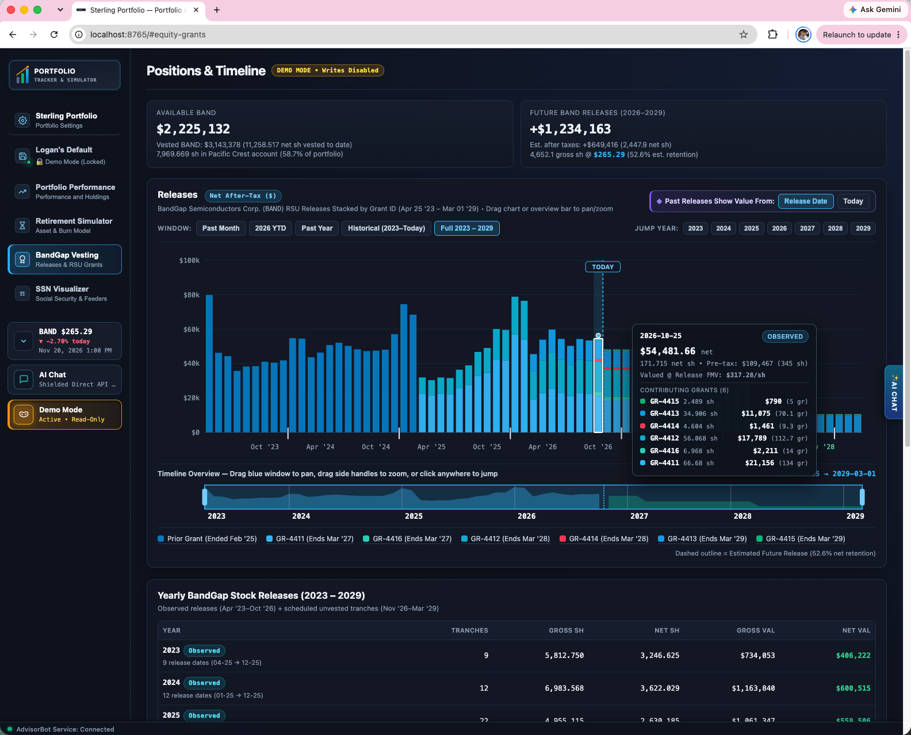
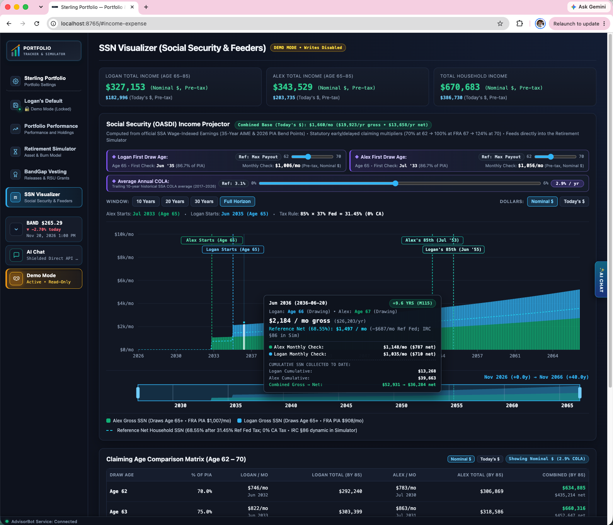
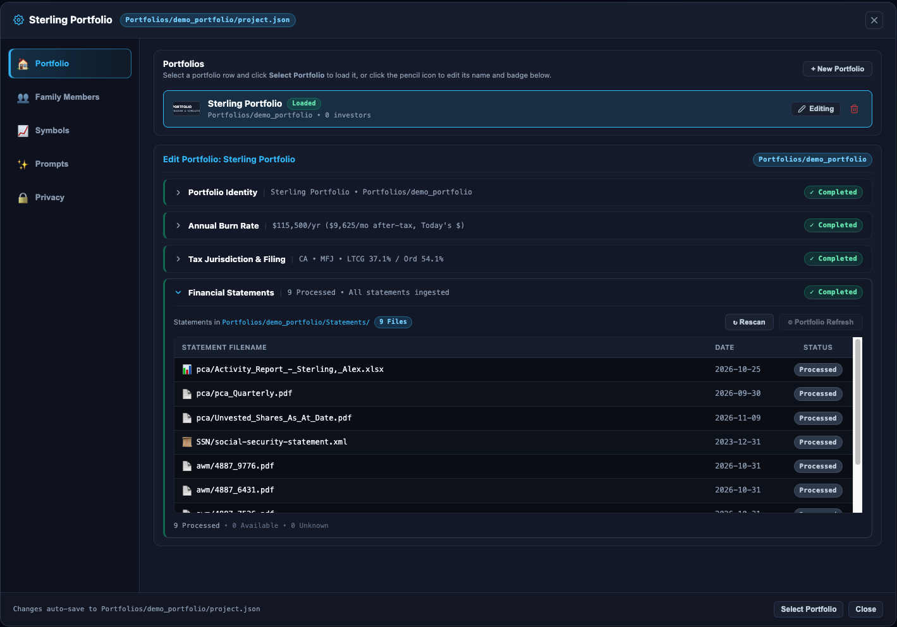
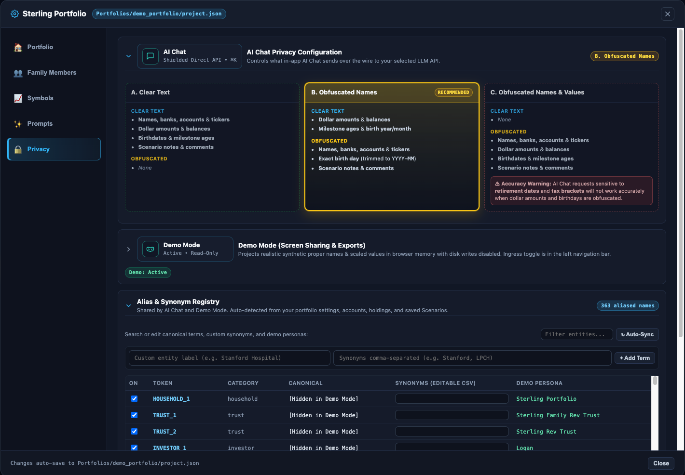
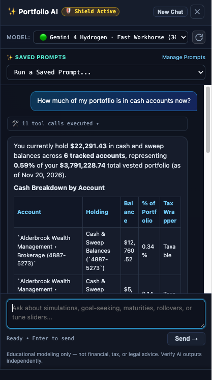
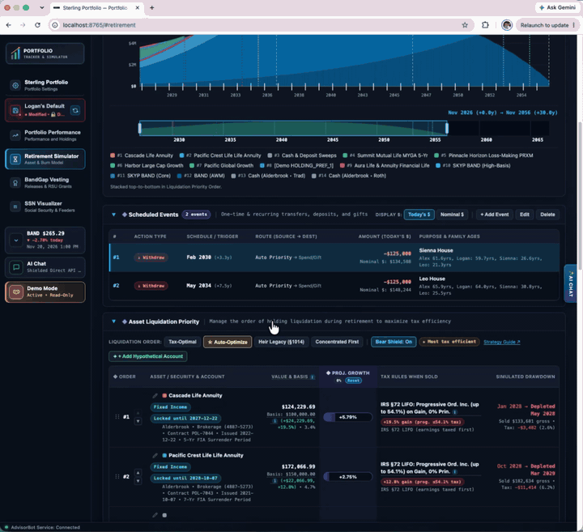

# AdvisorBot — Tax-Aware Retirement Simulator & Portfolio Analytics

An interactive, local-first portfolio analytics, statement ingestion, and tax-aware retirement simulation platform for households and equity-compensated professionals. Use it to explore whether your savings can support planned spending and how different retirement choices affect that outlook. Taxes, required withdrawals and Social Security benefits are estimates used in those forecasts.

> [!IMPORTANT]
> **Financial, Tax & AI Disclaimer:** AdvisorBot is free, self-hosted software for **educational and personal modeling purposes only**—it is **not** financial, investment, tax, or legal advice, and does **not** create an RIA/fiduciary relationship. Tax logic, Monte Carlo paths, and AI Chat / MCP outputs are simplified or probabilistic and must be verified independently before acting. See [DISCLAIMER.md](DISCLAIMER.md) for the full terms.

> [!TIP]
> **Interactive HTML View:** For full-resolution image zoom and inline HD video playback of the walkthrough, open [README.html](README.html) (or [Docs/readme.html](Docs/readme.html)) in your web browser.

---

## (A) Synopsis

**AdvisorBot** is a privacy-first financial planning dashboard that runs locally on your computer. It imports PDF, Excel (XLSX), JSON, and Social Security (SSA XML) statements into a private local database, and supports custom parser plugins for additional institutions or file formats.

From this consolidated view of your accounts, AdvisorBot serves a self-contained web dashboard covering:
1. **Portfolio Performance**: Consolidated positions, account and strategy allocation breakdowns, Yahoo Finance market pricing, editable holding forecasts with tooltips showing the selected source, dates and available alternative rates, and a historical-through-forecast weekly portfolio timeline (`Nominal $` / `Today's $`).
2. **Stock Vesting**: Multi-grant RSU/GSU tracking, historical release-date Fair Market Value (FMV) vs. current market value, tax withholding retention ratios, and future scheduled vesting timelines.
3. **Retirement Simulator**: Monthly progressive-tax drawdown engine modeling high-basis vs. low-basis equity tranches, capital loss carryforwards, IRS §72 LIFO non-qualified annuities, SECURE 2.0 Required Minimum Distributions (RMDs) starting at age 73 or 75, Roth vs. Traditional IRA wrappers, pre-retirement work/401(k) plans, and scheduled cashflow actions under **Simulation Controls**: **Market Correction** (`None`, crash presets, or custom downturn) and **Simulation** (`None`, **Monte Carlo**, or **1929–2025 Multi-Asset Historical Cohorts**). Holding Details charts 40 years of projected annual returns and lets you set multi-tier mean-reversion half-lives.
4. **SSN Visualizer**: Social Security OASDI Primary Insurance Amount (PIA) bend-point calculations from official `ssa.gov` XML statements, claiming-age modeling (ages 62–70), COLA compounding, and retirement feeder integration.
5. **Scenarios**: Interactive what-if scenario manager for saving, duplicating, comparing, recording AI Advisor concurrences under `## Upvotes & Concurrences` in **Details & Notes →**, and toggling `🔒 Protected` / `🔓 Unprotected` per scenario against accidental edits or deletion.
6. **In-App AI Assistant & MCP Integration**: Local (Ollama, LM Studio) and cloud (Gemini, Claude, OpenAI) AI support with configurable Privacy Shield modes (**A. Clear Text**, **B. Obfuscated Names**, and **C. Obfuscated Names & Values**), read-only **Demo Mode** for screen shares, and a Model Context Protocol (MCP) server for connecting external AI assistants.

All statement parsing, data storage, and portfolio math run strictly on your local machine (`localhost`). No brokerage login credentials or raw statements are sent anywhere. Market quotes fetch only public ticker symbols from Yahoo Finance; when using cloud AI providers, outbound messages follow your chosen Privacy Shield mode (**A. Clear Text**, **B. Obfuscated Names**, or **C. Obfuscated Names & Values**).

### Gallery

| | |
| :---: | :---: |
| <br>**Portfolio Performance** | <br>**Holding Details & Forecast** |
| <br>**Stock Vesting & Grants** | <br>**SSN Visualizer** |
| <br>**Portfolio Settings** | <br>**Privacy Shield & Settings** |
| <br>**In-App AI Assistant** | [](Assets/gallery/Simulation.mov)<br>**Retirement Simulation Walkthrough** ([Simulation.mov](Assets/gallery/Simulation.mov) · [GIF](Assets/gallery/Simulation.gif)) |

---

## (B) Setup and Workflow

### 1. Quickstart Prerequisites
- **Python 3.11+** installed (the core valuation/simulator runs on the Python standard library)
- **Git** installed (or download and extract the repository ZIP archive)
- **Modern web browser** (Chrome, Firefox, Safari, Edge)
- **Internet access at refresh time** (optional — only needed to fetch public ticker quotes/10Y history from Yahoo Finance; offline tests and `--offline` plugin checks work without network access)

On the GitHub repository page, choose **Code** and copy the HTTPS URL. Run `git clone` with that URL, then open a terminal in the cloned folder (or extracted ZIP folder). Create a virtual environment and install the optional extras (`ingest` for PDF/XLSX statement parsing via `pypdf`/`openpyxl`, `mcp` for external desktop agents, `ui` for `Pillow` badge image processing; add `dev` if running the `pytest` suite):

- **macOS** (Terminal — `zsh` / `bash`):
  ```bash
  # Verify Python 3.11+ (if needed, install via Homebrew: brew install python@3.12)
  python3 --version

  # Create & activate a virtual environment, then install dependencies
  python3 -m venv .venv
  source .venv/bin/activate
  python -m pip install -e ".[mcp,ingest,ui]"
  ```

- **Linux** (Terminal — `bash` / `zsh`):
  ```bash
  # Verify Python 3.11+ & venv support
  # Ubuntu / Debian: sudo apt update && sudo apt install -y python3 python3-venv python3-pip
  # Fedora / RHEL:   sudo dnf install -y python3 python3-pip
  python3 --version

  # Create & activate a virtual environment, then install dependencies
  python3 -m venv .venv
  source .venv/bin/activate
  python -m pip install -e ".[mcp,ingest,ui]"
  ```

- **Windows** (PowerShell or Command Prompt):
  ```powershell
  # Verify Python 3.11+ (if needed, install via winget: winget install Python.Python.3.12)
  py -3 --version

  # Create & activate a virtual environment, then install dependencies
  py -3 -m venv .venv
  .\.venv\Scripts\Activate.ps1   # In Command Prompt (cmd.exe): .venv\Scripts\activate.bat
  python -m pip install -e ".[mcp,ingest,ui]"
  ```
  > *Windows PowerShell note:* If script activation is blocked, run `Set-ExecutionPolicy -Scope CurrentUser RemoteSigned` once in PowerShell, or invoke `.\.venv\Scripts\python.exe` directly without activating.

### 2. Standard User Workflow
1. **Start & Open the Dashboard**:
   Run the local dashboard server from the `AdvisorBot` repo root:
   - **macOS**:
     ```bash
     .venv/bin/python Scripts/advisorbot_server.py --open
     ```
   - **Linux**:
     ```bash
     .venv/bin/python Scripts/advisorbot_server.py --open
     ```
     *(On headless or WSL setups without a desktop browser opener, omit `--open` and open the printed `http://127.0.0.1:8765/?token=...` URL manually.)*
   - **Windows**:
     ```powershell
     .\.venv\Scripts\python.exe Scripts\advisorbot_server.py --open
     ```
   *(If your `.venv` virtual environment is already activated in the current terminal, `python Scripts/advisorbot_server.py --open` works on all platforms.)* This starts the local dashboard on `http://127.0.0.1:8765/` and opens an authenticated session in your browser.
   > **Local session.** Use AdvisorBot on a trusted personal device. Run `--open` to start the server or open the verified instance already running on that port. The browser automatically exchanges the launch link for a signed, year-long cookie. Bookmark the clean dashboard URL for later visits. The launch link works once and has no countdown while that server is running. Browser cookies are shared across ports on the same hostname.
2. **Create & Configure Your Portfolio (`Settings ⚙️`)**:
   Open **Portfolio Settings (⚙️) > Portfolio**, click **+ New Portfolio** (or initialize `Portfolios/<PortfolioName>/` manually per [Chapter 1](Docs/ch1-portfolio-setup.html#portfolio-dir)), and complete the required fields (**Portfolio Name**, **Annual Burn Rate**, **Tax Jurisdiction & Ceilings**, and at least one **Family Member Name & Birthdate**) so the portfolio moves from **Incomplete** to ready and **Select Portfolio** activates. Use the remaining Settings tabs to set **Symbols** (tracked tickers/indices with your primary equity first), **Prompts**, and **Privacy** (AI Chat Privacy Shield A/B/C, Demo Mode, Alias Registry, MCP toggle).
3. **Add Statements & Refresh**:
   Drop brokerage statements into `Portfolios/<PortfolioName>/Statements/` (supports Wells Fargo `.pdf`, Morgan Stanley `.pdf`/`.xlsx`, `*.statement.json`, and `*.grants.json`), then click **↻ Rescan** and **⚙ Portfolio Refresh** in **Settings > Portfolio**. Upload official `ssa.gov` `.xml` earnings statements per investor inside **Settings > Family Members > Select ssa.gov XML file**.
   For unsupported institutions, see [Chapter 1, Section 1.5](Docs/ch1-portfolio-setup.html#agent-plugins) to convert exports into universal `*.statement.json`, or inspect and build a custom `StatementPlugin` in `Portfolios/<PortfolioName>/Plugins/` (via `Scripts/holdings.py inspect-statement` and `test-plugin --offline`, opted in via `allowed_plugins` in `project.json`).
4. **Explore & Model**:
   - Inspect aggregated holdings, asset allocation, and vesting timelines.
   - Experiment in the **Retirement Simulator** using **Simulation Controls** (**Market Correction** + **Simulation**: `None`, `Monte Carlo`, `Historical`), **Inclusions**, and **Overrides**.
   - Save what-if scenarios, toggle `🔒 Protected` / `🔓 Unprotected` on benchmark plans, or consult the in-page AI Financial Assistant. A saved Advisor workflow presents its analysis first. If it proposes a new scenario or a vote/concurrence on an existing scenario, choose the corresponding button to apply it (an Advisor vote appends a timestamped signature under `## Upvotes & Concurrences` in **Details & Notes →**).

---

## (C) Index of User Documentation

Comprehensive guides and reference manuals live in the [`Docs/`](Docs/) directory. Open [`Docs/index.html`](Docs/index.html) in a browser for the interactive manual:

1. [**Docs/index.html — User & System Guide Portal**](Docs/index.html):
   - [**Chapter 1: Setting Up Your Portfolio**](Docs/ch1-portfolio-setup.html): Creating a portfolio folder, configuring portfolio settings, adding statements, reviewing **Settings > Portfolio** status indicators, and writing custom statement plugins.
   - [**Chapter 2: Core Application Walkthrough**](Docs/ch2-core-walkthrough.html): Walkthrough of the main screens and models:
     - *Portfolio Performance*: Holdings summary, live ticker pricing, and historical-to-forecast weekly timeline.
     - *Stock Vesting*: Grant-level vesting schedules, FMV basis tracking, and share retention.
     - *Retirement Simulator*: Tax prioritization, tranche drawdown, RMDs, stress-test tabs, drag-and-drop liquidation order, and forecast baselines.
     - *SSN Visualizer*: Earnings history, OASDI bend-point math, and claiming-age optimization.
     - *Scenario Management*: Creating, comparing, recording `## Upvotes & Concurrences` in **Details & Notes →**, and toggling `🔒 Protected` / `🔓 Unprotected` per scenario.
     - *Holding Forecast Methodology*: Return projections and confidence indicators.
   - [**Chapter 3: Security & Privacy Architecture**](Docs/ch3-security-privacy.html): Local-only architecture, session authentication, Privacy Shield profiles (**Clear Text**, **Obfuscated Names**, **Obfuscated Names & Values**), Demo Mode, and local AI setup.
   - [**Chapter 4: Developer & Agent Integration**](Docs/ch4-developer-agent.html): Model Context Protocol (MCP) server setup, privacy boundaries, engineering guardrails, isolated fixture test suite reference, and contributor commit template.
2. [**Examples/ Directory**](Examples/):
   - [`project.example.json`](Examples/project.example.json) & [`grants.example.json`](Examples/grants.example.json): Starter templates for portfolio configuration and equity-grant schedules.
   - [`llm_config.gemini.json`](Examples/llm_config.gemini.json), [`llm_config.claude.json`](Examples/llm_config.claude.json), [`llm_config.openai.json`](Examples/llm_config.openai.json), [`llm_config.local_ollama.json`](Examples/llm_config.local_ollama.json) (see [`README_LLM_CONFIGS.md`](Examples/README_LLM_CONFIGS.md)): Starter templates for cloud and local AI providers.
   - [`mcp_config.example.json`](Examples/mcp_config.example.json): Starter configuration for connecting external MCP clients.
3. **Contributor Guides & Templates**:
   - [`CONTRIBUTING.md`](CONTRIBUTING.md): Contributor workflow, engineering/privacy guardrails, and isolated fixture test commands.
   - [`.gitmessage`](.gitmessage): Standardized Git commit template (`git config commit.template .gitmessage` or `make commit-template`).

---

## (D) License, Attribution & Disclaimer

- **License**: Released under the **BSD 3-Clause License** — see [LICENSE](LICENSE).
- **Attribution**: Derivative works and redistributions must preserve the copyright/license notice and should acknowledge **AdvisorBot** per [NOTICE](NOTICE). Per Clause 3 of the BSD 3-Clause License, neither the name **AdvisorBot** nor contributor names may be used to endorse or promote derived products without prior written permission.
- **Disclaimer**: Review [DISCLAIMER.md](DISCLAIMER.md) before using simulations, tax estimates, market quotes, or AI Chat / MCP outputs.
